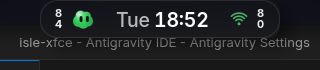
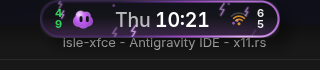
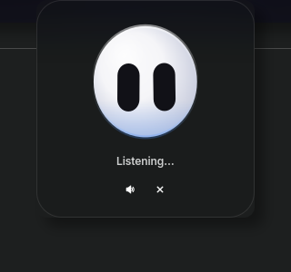
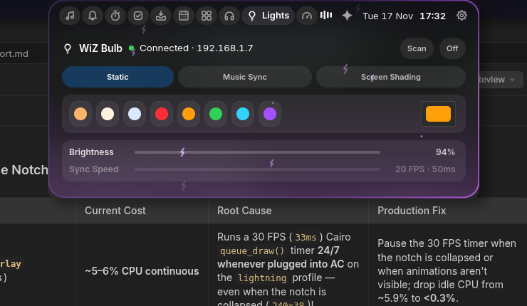
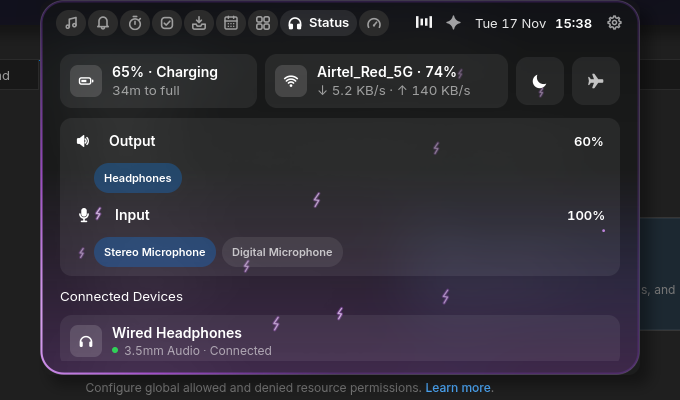
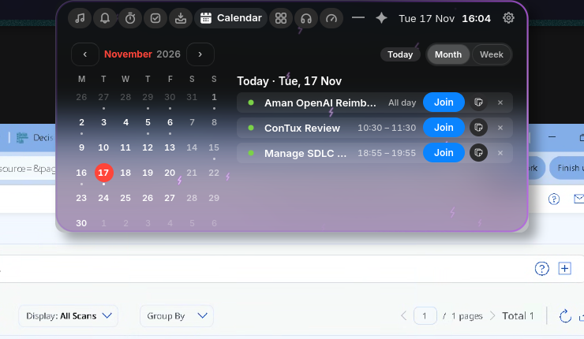
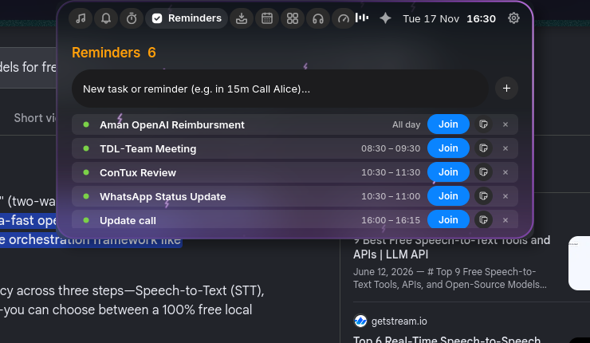
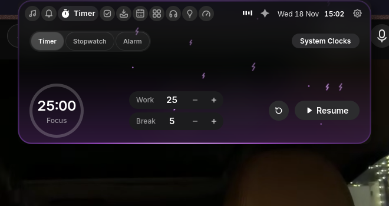
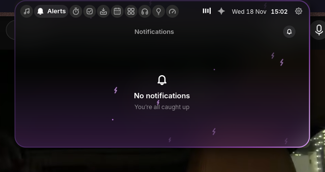

<div align="center">

# 🏝️ Isle XFCE

**A Dynamic Island-style floating notch for XFCE & X11.**

Media controls, WiZ smart light music sync, hardware battery charge capping, a month/week calendar, Pomodoro focus timer, smart alerts, and a live Talkback voice assistant — all living in a sleek, spring-animated notch at the top of your screen.

[](LICENSE)


<br>

 &nbsp;&nbsp; 

<br>



</div>

---

## ✨ Why Isle XFCE?

Your XFCE desktop doesn't need boring, center-screen popups or cluttered top panels. **Isle** floats quietly at the top center of your display as an `override_redirect` X11 pill — never stealing window focus until you want it.

- **3-Tier Adaptive Geometry**:
  - **Compact Pill (`240×38`)**: Live clock, vertical battery %, Wi-Fi strength, and your animated assistant avatar.
  - **Expanded Hub (`600×300`)**: Hover or click to unfold with spring physics into your media, lights, calendar, timer, and system controls.
  - **Assistant & Talkback (`640×380`)**: Press `Super+I` to speak or type requests, get spoken replies, and interact with a live animated voice overlay.
- **Persistent Settings**: All preferences — power profiles, Do Not Disturb, WiZ light presets, calendar view, alarms, and battery charge limits — automatically save to `~/.config/isle/settings.json` and survive reboots.

---

## 🚀 Features Showcase

<table>
<tr>
<td width="50%" valign="top">
<br><br>
<b>💡 WiZ Smart Lights & Music Sync</b><br>
Discover and control WiZ smart bulbs on your LAN directly from the notch. Adjust brightness, warm/cool temperature, RGB colors, or enable <b>Music Sync</b> so your room lights pulse in real time with your audio.
</td>
<td width="50%" valign="top">
<br><br>
<b>🔋 Status, Audio & Hardware Charge Guard</b><br>
Switch audio outputs (Speakers / Headphones) in one click, toggle Silent / Balanced / Lightning modes, and enable <b>Auto Stop</b> to cap laptop battery charging at a custom threshold (e.g. 70%) via HP EC/WMI hardware control. Compact battery digits turn <span style="color:#0a84ff"><b>blue</b></span> when capped on AC.
</td>
</tr>
<tr>
<td width="50%" valign="top">
<br><br>
<b>📅 Month & Week Calendar</b><br>
Switch seamlessly between interactive Month and Week grids. View upcoming events, get 5-minute meeting reminders with one-click <b>Join</b> buttons, and keep track of your schedule without opening a browser.
</td>
<td width="50%" valign="top">
<br><br>
<b>✅ Snappy Reminders</b><br>
Jot down quick tasks right inside the notch. Add, edit inline, or check items off with smooth strikethrough and instant persistence.
</td>
</tr>
<tr>
<td width="50%" valign="top">
<br><br>
<b>⏱️ Focus Timer & Alarms</b><br>
Built-in Pomodoro focus timer with customizable work/break intervals, auto-DND while focusing, and a persistent alarm system. While running, your remaining time stays visible on the compact pill.
</td>
<td width="50%" valign="top">
<br><br>
<b>🔔 Non-Intrusive Notch Alerts</b><br>
Volume, brightness, Caps Lock, charging status, low battery, and desktop notifications appear inside the notch instead of blocking the middle of your screen. Hover to hold, or click/swipe away.
</td>
</tr>
</table>

### Plus More Built-In Goodies
- **⚡ Lightning AC Mode**: Plug in AC with the Lightning profile active to unleash rising Cairo-rendered lightning bolts and an animated perimeter glow around the notch.
- **🎙️ Live Talkback Voice Assistant**: Powered by **NVIDIA NIM** + local **Whisper / Parakeet STT** + **Piper TTS**. Ask questions, run system actions, or have a natural hands-free back-and-forth with an expressive, bouncing bot face.
- **🎵 MPRIS Media & Synced Lyrics**: Control Spotify, browsers, or any MPRIS player with album art and synced lyrics.
- **📋 Clipboard Shelf & Drag-and-Drop**: Quick access to recent text, images, and dropped files.

---

## 🛠️ Quick Start (Installation)

### 1. Install Dependencies

**Arch Linux:**
```sh
sudo pacman -S --needed base-devel git rust gtk4 gjs libx11 python
```

**Ubuntu / Debian:**
```sh
sudo apt install git build-essential pkg-config libgtk-4-dev gjs libx11-dev python3
curl --proto '=https' --tlsv1.2 -sSf https://sh.rustup.rs | sh
```

### 2. Clone & Build
```sh
git clone https://github.com/BUTDRILL1/isle-xfce.git
cd isle-xfce
cargo build --release -p isle-daemon -p isle-ui
```

### 3. Run Setup & Start Services
The setup script installs `isled` and `isle-ui` to `~/.local/bin`, registers systemd user services, adds autostart, and binds `Super+I` in XFCE:

```sh
./scripts/setup-xfce.sh
systemctl --user enable --now isled.service isle-ui.service
```

> [!TIP]
> Want the Voice Assistant? Pass your NVIDIA NIM key during setup:
> ```sh
> ./scripts/setup-xfce.sh --nim-key "nvapi-..."
> ./scripts/setup-voice.sh
> ./scripts/setup-tts.sh
> ```

### 4. Optional: HP Hardware Battery Charge Limit
If you use a supported HP laptop (ACPI `WMID` `SBCO`/`GBCO`), install the root charge-limit service so **Auto Stop** holds your battery at your chosen % (e.g. 70%) on AC power:

```sh
sudo ./scripts/install-hp-charge-limit.sh
```

---

## 🎮 Controls & Shortcuts

| Action | Result |
|---|---|
| **Hover** over the notch | Unfolds the expanded hub (`600×300`) with spring physics |
| **Move pointer away** / `Esc` | Collapses back to the compact pill (`240×38`) |
| **Click** the notch / alert | Opens the relevant tab or expands immediately |
| **Middle-click** the notch | Play / Pause current media |
| **Right-click** the notch | Dismisses active alert or focuses the media player |
| `Super + I` | Toggles the **Live Talkback / Voice Assistant** (`640×380`) |

---

## 🧩 Architecture (For Developers)

```text
isle-xfce/
├── crates/
│   ├── isle-core/      # Shared IPC types, state models, & helpers
│   ├── isle-daemon/    # Background daemon (isled): MPRIS, notifications, NIM AI, telemetry
│   ├── isle-ui/        # Native Rust + GTK4 + X11 window harness (3-tier geometry & spring physics)
│   ├── isle-shelf/     # GTK4 drag-and-drop & clipboard shelf helper
│   └── isle-whisper/   # Local speech-to-text helper
├── ui/                 # GJS / GTK4 frontend views, Cairo overlays (lightning.js), & CSS
│   ├── pages/          # Modular tabs (devices, lights, calendar, timer, usage, settings)
│   └── wiz_bridge.py   # UDP WiZ smart bulb discovery & real-time audio spectrum sync
└── scripts/            # XFCE setup, voice/TTS installers, & HP EC charge-limit daemon
```

---

## 🙏 Credits & License

- **Original Base**: Built upon the awesome GNOME Shell Island project **[zickrian/isle](https://github.com/zickrian/isle)**. Credit to **zickrian** for the original Dynamic Island design, core Rust daemon, and UI foundation.
- **XFCE / X11 Port & Upgrades**: Re-engineered for standalone XFCE/X11 (`isle-ui`), adding the 3-tier `override_redirect` window engine, WiZ smart light audio sync, HP EC hardware charge limiting, Month/Week calendar views, Lightning AC mode, Live Talkback voice overlay, and persistent configuration.
- **License**: Distributed under the **GNU General Public License v3.0 or later** ([LICENSE](LICENSE)).
